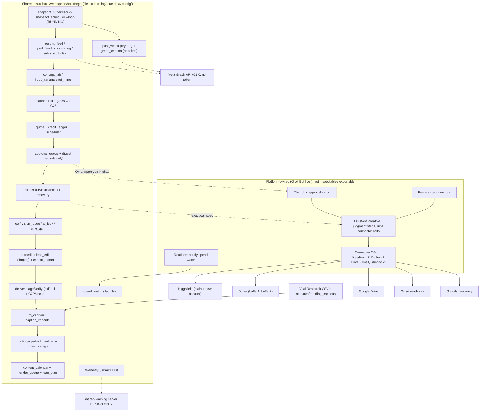

# Hookforge Technical Blueprint (read-only assessment)

**Prepared for:** Omar · **Date:** Tue 2026-10-20, ~5:15 PM PT · **Scope:** current state of Hookforge on the shared Linux box, plus a path to running it on AWS.
**Method:** I only read files and ran inspection commands (`ps`, `du`, `df`, `/etc/os-release`, `rg`, AST docstring dumps). Nothing was modified, deployed, generated, posted, sent or spent. No Higgsfield, Buffer or Shopify tools were called. I didn't run the test suite, because several tests write into `learning/`. Secret values were never read or printed; env-var **keys** are named only.

### Evidence labels
| Label | Meaning |
|---|---|
| **[V]** Verified | Seen directly in a file, function, config key or command output (cited) |
| **[I]** Inferred | Follows from verified facts, but not observed directly |
| **[R]** Reported-but-unverified | Stated in docs/DECISIONS/HANDOFF, but no artifact on the box proves it |
| **[U]** Unknown | No evidence either way |
| **[P]** | Platform-owned (Grok Bot host), not inspectable or exportable |

---

## 1. Executive summary

1. **[V]** Hookforge is a pure-Python package (`engine/hookforge/`, 90+ modules, about 10.2K lines) plus JSON/CSV config and data. The repo is `/workspace/hookforge` (15 GB). It is a git repo with **no commits** (`git log`: "branch 'master' does not have any commits yet").
2. **[V]** The engine **never calls Higgsfield or Buffer itself**. `runner.next_call` returns the *exact connector call* `{namespace, tool, arguments}` for the assistant to run. `publish.ready_payload` returns a Buffer `create_post` payload in the same way. The only direct network code is the Meta Graph GET/POST in `results_feed.py` and `graph_caption.py` (both need env tokens, and neither token is set), plus small fetchers (`textcards.py` emoji PNGs, `music/fetch_song.py`, `voice/collect_tiktok.py`).
3. **[V]** Live generation in the runner is **disabled** (`config.LIVE["enabled"] = False`, account `user-Higgsfield--new-account`). Auto-posting is disabled (`posting.AUTO_POST_ENABLED = False`). Shared-learning telemetry is disabled (`telemetry.ENABLED = False`).
4. **[V]** Even so, **real Higgsfield spend happened outside the runner gate**. `learning/spend_ledger.csv` holds 1,048 cr on 10-19 and 645.5 cr on 10-20. The 10-20 runs were approved in chat and recorded only in `config/credit_caps.json`, with notes like "no approvals/<run>.json". `learning/credit_ledger/reconcile_2026-10-20.json` and `learning/alerts/unledgered_spend.json` show **298.15 cr of unledgered spend** on the new account.
5. **[V]** Exactly **one Hookforge background process** runs on the box: `automation/snapshot_supervisor.sh` (PID 1863823, up about 2 h 39 m) and its child `python3 -m hookforge.snapshot_scheduler --loop` (PID 1864069). It ticks hourly. Every tick since 14:32 PT logged `rows: 0`, `graph: off (META_TOKEN not set)` (`learning/results/snapshot_log.jsonl`). It has no data to work on yet.
6. **[V]** There is **no cron, no systemd and no crontab binary** on the box. Every other schedule (hourly spend watch, daily or weekly regen) depends on the assistant or a host routine.
7. **[V]** The **shared-learning server is design only**. `shared/server/` contains only `classify.py` (16 lines) and `promote.py` (21 lines). There is no FastAPI app, Dockerfile, DB schema or `config/shared_learning.json`, and `telemetry.send()` writes to a local outbox (`shared/outbox`, which doesn't exist yet). Docs: `docs/SHARED_LEARNING_PLAN.md`, "Status: DESIGN + local disabled scaffold".
8. **[V]** The pipeline state is fully dry. `learning/render_queue/2026-10-21.json` has 20/20 slots `DRAFT - NEEDS_VIDEO`, `learning/publish_queue/` is empty, and 4 items sit in `learning/approval_queue/` as `AWAITING_OMAR_APPROVAL` (3 concepts at 200 cr, plus a weekly batch at 1,227 cr in the lean option). Buffer preflight passed 20/20 against a stand-in URL (`learning/buffer_preflight/2026-10-21.json`).

---

## 2. Host environment (the shared box) [V unless noted]

| Item | Value | Source |
|---|---|---|
| OS | Debian GNU/Linux 13.7 "trixie" | `/etc/os-release` |
| CPU / RAM / swap | 8 vCPU / 15 GiB / none | `nproc`, `free -h` |
| Uptime at inspection | 22 h 05 m | `uptime` |
| Python | 3.13.5 | `python3 --version` |
| Media tools | ffmpeg/ffprobe 7.1.5, exiftool, tesseract | `which`, `ffmpeg -version` |
| Not installed | `pandoc`, `c2patool`, cron, systemd | `which` (C2PA detection is implemented in Python in `deliver.py`, not with c2patool) |
| ML libs | torch 2.14.1+cpu, open_clip_torch 3.3.0, faster-whisper 1.2.1, jsonschema 4.26 | `pip list` |
| Root FS | 125 GB, **97 GB used (77%)**, 29 GB free | `df -h` |
| `/workspace` total | 66 GB | `du -sh` |
| `/workspace/hookforge` | **15 GB** | `du -sh` |

**Repo disk breakdown [V]:** `out/` 6.0 GB (`out/live` 3.1 G, `out/deliver` 1.4 G, `out/pv_edit` 868 M, `out/purrventure_frames` 367 M), `data/` 5.7 GB (`data/features/proxies` 5.4 G), `learning/` 1.2 GB (**`learning/results/video_registry.csv` alone is 1.1 GB**), `assets/` 641 M, `refs/` 502 M, `style/` 180 M, `music/` 67 M, `analytics/` 11 M, `private/` 6.2 M, `engine/` 4.0 M.

**Processes [V, `ps -eo`]:** only two are Hookforge (the supervisor and the snapshot loop). Everything else is box infrastructure: desktop/VNC sessions, the exec daemon, the browser, the session/cookie/egress helpers, the memory watcher. → **[P] Platform-owned (Grok Bot host), not inspectable or exportable.** The loop's environment holds no `META_*` key. The other env keys it holds are host-injected [P], and none is read by Hookforge code (`rg os.environ`).

**Env-var keys Hookforge reads [V, `rg os.environ`]:** `META_TOKEN` (results_feed, snapshot_scheduler; unset), `META_PAGE_TOKEN` (graph_caption.TOKEN_ENV; unset), `HOOKFORGE_USE_DB` (reels_db; unset), `HOOKFORGE_INSIGHTS_DIR` and `HOOKFORGE_WORKSPACE` (analytics). Values: redacted / not set.

---

## 3. Component diagram

**Flow [V, `docs/HANDOFF.md` "Architecture map"]:** `concept_lab.daily` → `planner` → `fit.assess` → `gates.run_all` (G1–G25) → `runner.preflight`/`build_calls` (quote) → `approval_queue` → [Omar approves; spend] → edit/CapCut draft → caption → `routing.route` → `publish.build_payload` (draft only). `e2e_dryrun.run` exercises the whole chain without spending. One command, `python3 -m hookforge.regen` (D154), rebuilds calendar → concepts → weekly batch/lean → render queue → Buffer preflight → digest.

---

## 4. Components

Standard fields: **What · Where · Owner · Start · Reads · Writes · Talks to · Auth · Persists · Failure/restart.** "Owner" means the code owner inside Hookforge. Omar owns the business decisions.

### 4.1 Concept lab, planner and gates
- **What [V]:** `concept_lab.daily()` proposes 1 new concept per active product (the 20% innovation slot, least-tried format from `learning/arms.csv`). It ranks concepts with `rank()` = 0.5·POC + 0.3·season + 0.2·page gap, plus a `ref_miner` boost (D111/D134). `weekly()` fills the calendar with the fewest videos. `planner.plan()` turns a brief into a full plan: product world (`worlds`, `profiles`), RECREATE mode when `refs/recreate/<product>.json` exists (D61), music, caption, prompts and cost. `fit.assess` handles format fit. `gates.run_all` runs G1–G25, including G2 (8-word hook, D149), G5 quote, G17 budget, G23 SAY-not-Comment, G24 world and G25 `political_lint`. `logic`, `audience_fit`, `style`, `motion_rules` and `ref_gate` (no gen without product and cast refs) add lint and gates.
- **Where:** box, in-process Python. **Owner:** Hookforge engine. **Start:** on demand (the assistant runs it, or `hookforge.regen`) [V]. No scheduler starts it [V: no cron].
- **Reads:** `config/products.json`, `config/poc_defaults.json`, `formats/*.json`, `audience/*.yaml`, `learning/arms.csv`, `learning/gen_failures/rules.csv`, `learning/perf/weights.json` (absent, so all weights are 1.0) [V].
- **Writes:** `learning/approval_queue/<id>.json`, `learning/hook_variants/<day>.json`, `learning/weekly_batch/`, `learning/audience_fit_log.csv` [V].
- **Talks to:** nothing on the network [V]. **Auth:** none. **Persists:** JSON on disk [V].
- **Failure:** exceptions bubble up to the caller. BLOCK gates stop a plan and FIX gates re-plan once (`docs/AUTOMATION.md`) [V/R]. Pytest cache last run: 1 failure, `tests/test_gates.py::test_g2_own_proven_verbatim_exempt` [V, `engine/.pytest_cache/v/cache/lastfailed`]. This is consistent with D149 removing that exemption, so the test is stale [I].

### 4.2 Quoting, credit ledger and scheduler
- **What [V]:** `gates.quote`/`video_cost` price plans (D57/D140: Seedance 2.5 1080p 4 s = 64, 720p 4 s = 28; GPT Image 2 2k high = 6.5; per video about 200 cr standard). `credit_ledger` (D120/D121/D126) does `spent`, `daily`, `status`, `precheck` (warns at 80%, refuses over cap, with no cap, or on closed runs), `log_job` (the single spend write path, dedup by job id) and `reconcile` (matches the Higgsfield `transactions` feed by amount ±15 min). `scheduler` (D91 #1): at most 5 jobs per PT day, `DAILY_CREDIT_CAP = 5 × CREDIT_BUDGET_PER_VIDEO (175)` = 875. It only queues and checks dispatch.
- **Where:** box. **Start:** called by `runner.next_call` or manually [V]. `learning/schedule/` is empty, so the scheduler has never been used [V].
- **Reads:** `learning/spend_ledger.csv` (104 lines), `learning/approvals/*.json`, `config/credit_caps.json` [V]. **Writes:** `learning/spend_ledger.csv` (append via `gates.ledger_add`), `learning/credit_ledger/<day>.json`, `reconcile_<day>.json` [V].
- **Talks to:** nothing directly. The assistant passes in Higgsfield `transactions` output [V].
- **Persists:** CSV/JSON [V]. **Failure:** a refused precheck blocks the call. Ledger completeness depends on every spend going through `log_job`. It doesn't today: 298.15 cr is unledgered (D126) and the purrventure branding v2 spend is unknown (`credit_caps.json` note) [V].

### 4.3 Higgsfield generation runner and recovery
- **What [V]:** `runner.start_run` → `next_call` (re-checks the gate on *every* call; get_cost first, then the paid submit) → `record_cost`/`record_submit`/`record_result` → `judge` (vision_judge, at most 1 re-roll per shot). The gate requires `LIVE.enabled`, `live=True`, and `learning/approvals/<run_id>.json` with `approved_by == "Omar"`, a plan sha256, gen ids, an account, a cap of at least the total, not expired and not consumed. Lean variants: `build_calls_lean`, `assemble_lean` (D145). `recovery` (D91 #2/D128): `scan` (states ok/pending/STUCK/failed_*; TIMEOUT still 10 min, video 45 min), `retry` (max 2, retryable causes only), `resume`, `clear_inflight`. Saves are atomic (tmp + fsync + replace) and an in-flight marker stops double submits.
- **Where:** box for the logic. The paid calls run through the **host connector** `user-Higgsfield--new-account` (or `user-Higgsfield`), and only the assistant can call it [V: runner docstring]. → **[P]** for the call path.
- **Start:** the assistant, after Omar's chat approval and the approval file [V]. **Reads/Writes:** `out/live/<run_id>/run.json`, `learning/approvals/`, `learning/gen_failures/ledger.csv` [V].
- **Auth:** host-held connector OAuth [P]. Hookforge holds no Higgsfield key [V: no env or key file referenced].
- **Persists:** yes (run.json). **Failure:** a STUCK step is polled and never resubmitted. Gate failures refuse. Restart = `recovery.resume(run_id)` [V]. Approvals on record: `mg-tvn-001` (174, consumed) and `mg-tvn-001-b3` (34.5, consumed), `jollyglow_321_frames` (236), `jollyglow_combo_frames` (164), and `long_gens` (no approver) [V]. The 10-20 PurrVenture runs (645.5 cr) were done **without** runner approval files [V: credit_caps.json notes]. Because `LIVE.enabled` is False, they must have bypassed `runner` [I].

### 4.4 Editor (ffmpeg) and metadata strip/verify
- **What [V]:** `autoedit.final_cmd` (2160×3840), `clean_export` (fresh re-encode with provenance stripped), `clean_remux`, `relevel_audio`. `lean_edit.build` (ffmpeg re-order/trim of anchor bodies, perceptual-hash LCS overlap gate ≤50%, reveal check D147/D150). `songlay`, `iphone_grade`, `textcards` (Apple emoji PNGs, cached in `assets/emoji_apple/`), `capcut_export` (CapCut Mac 9.x draft). `deliver.stage`/`verify_staged` (D44d) is the only exit path. It runs a whitelist scan of `exiftool -a -G1 -ee -j` fields, the MP4 box tree, PNG/JPEG chunks and raw bytes for c2pa/jumbf/Lavf/Lavc/x264/x265/Higgsfield/… strings, has **no override**, and copies into `out/deliver/` (85 files, 1.4 GB). C2PA detection is structural (uuid box d8fec3d6… / JUMBF `c2pa` label, D44 addendum), implemented in Python (`deliver.c2pa_manifests`). c2patool is not used or installed.
- **Where:** box (CPU ffmpeg). **Start:** on demand. **Reads:** clips in `out/live/…`, `music/`, `assets/`. **Writes:** `out/…`, `out/deliver/manifest.json`.
- **Talks to:** `textcards.py` fetches emoji PNGs over HTTPS when they aren't cached [V]. **Auth:** none.
- **Failure:** `deliver.Refused` and CLI exit 2. `qa.final_checks` BLOCKs on provenance, repeats or splices [V]. Tests: `test_deliver.py`, `test_c2pa_strip.py` [V present; not run by me].

### 4.5 Caption module, routing and Buffer payloads
- **What [V]:** `fb_caption` (D93) builds the caption library (`learning/captions/*.json`), `generate()` (SAY CTA, Apple emoji, audience_fit, POC citation), `check_traction` (≥40K or +10K in 1 h; `SWAP_HOUR_GAIN = 10000`), `queue_swap`, and `ingest_trending()` from `/workspace/research/trending_captions/*.csv`. `caption_variants` (D101) makes per-page originality (Jaccard ≤0.45). `routing` (D94) reads `config/buffer_routing.json`: `route`, `capacity` (free plan 10 scheduled per account), `duplicate_channels`, `next_window`. `publish` (D78) does `prepare` → `deliver.stage` + caption gates → `learning/publish_queue/<id>.json` (`AWAITING_OMAR_APPROVAL`, `saveToDraft=True`, `mode=addToQueue`) → `approve` → `ready_payload`. `buffer_preflight` (D153) validates against `config/buffer_create_post.schema.json` (a Draft-7 snapshot of Buffer's `create_post` schema).
- **Where:** box. Posting itself would be the assistant calling the Buffer connector → **[P]**.
- **Reads:** routing and schema config, `config/product_urls.json` (trumpglow and purrventure_carrier are **PLACEHOLDER**) [V]. **Writes:** `learning/publish_queue/` (empty) [V], `learning/buffer_preflight/2026-10-21.json` (20/20 pass, stand-in `.invalid` URL) [V].
- **Auth:** host connector OAuth [P]. **Failure:** routing raises for locked, unconnected, over-limit or retired targets. No public video host exists yet for Buffer asset URLs (`HANDOFF.md` "no public video host") [V/R].

### 4.6 Calendar, render queue and lean plan
- **What [V]:** `content_calendar.week()` uses `CADENCE` {jollyglow_fb 4, trumpglow_fb 6, patriotsglow_fb 4, purrventures_fb 2, purrventures2_fb 3}, the midterms ramp to 2026-11-03, and per-account caps. `render_queue.build()` binds each slot to one APPROVED publish item or marks it NEEDS_VIDEO or NEEDS_URL, and `schedulable()` raises unless the slot is READY. `lean_plan` (D140–D143) is 1 anchor per product plus hook-only extras: **1,227 cr vs 2,600 standard** for the week.
- **State [V]:** `learning/calendar/2026-10-21.json`, 20 slots (trumpglow_fb 7, patriotsglow_fb 5, purrventures2_fb 3, jollyglow_fb 3, purrventures_fb 2). Render queue: 20/20 `DRAFT - NEEDS_VIDEO`. Weekly batch item: 1,227 cr, `AWAITING_OMAR_APPROVAL`, created 17:11 PT.
- **Where/Start:** box, on demand (`regen`). **Outputs:** `analytics/content_calendar.html`. **Network:** none. **Failure:** `NotSchedulable`.

### 4.7 Performance loop / ab_log, post-publish watcher and graph_caption
- **What [V]:** `results_feed` ingests Meta Business Suite CSVs from `learning/results/inbox/` (4 processed files; 1 snapshot, `2026-10-20T1002.csv`) and/or Graph GETs when `META_TOKEN` is set, and writes `reels.csv`, `outcomes.csv` and `velocity.csv`. `perf_feedback` (D119) does `ingest` → `learning/perf/stats.csv` → `reweight` → `weights.json` (multipliers in [0.5, 1.5]). **`learning/perf/` is empty, so it isn't producing live weights yet** [V]. Only a simulation exists in `learning/perf_sim`. `ab_log` (D91 #4) writes `learning/ab_variants.csv`, which **doesn't exist yet** [V]; `MIN_VIEWS = 500`. `sales_attribution` (D87) parses ShopifyQL result JSONs that the assistant saves to `analytics/data/shopify_utm/` (3 files dated 2026-10-20) [V].
- **post_watch (D136) [V]:** dry run only, using fixtures. It writes swap items to a temp dir and `learning/post_watch/dryrun_20261020_1621.json`.
- **graph_caption (D107) [V]:** **built, but there is no token.** It needs the `META_PAGE_TOKEN` env (scopes `pages_manage_posts`, `pages_read_engagement`), and the Graph base is `https://graph.facebook.com/v21.0`. It refuses unless the swap item is APPROVED with a matching text sha. The flow is GET verify → POST description → GET verify (`docs/GRAPH_CAPTION_EDIT.md`).
- **Auth:** Meta tokens, env only, entered through the host Secure Form → the token handoff is **[P]**. Neither token is set [V].
- **Failure:** without a token, `graph_caption.execute` raises `Refused` [V]. The manual fallback is pasting the caption in Business Suite and then `mark_swapped(id, "manual")` [V doc].

### 4.8 Snapshot scheduler (the only running component)
- **What [V]:** `snapshot_scheduler.tick()` → `results_feed` ingest → `fb_caption.check_traction` → `queue_swap` items (it never edits). It writes a snapshot only when there is new data, and logs to `learning/results/snapshot_log.jsonl`.
- **Start [V]:** `setsid nohup automation/snapshot_supervisor.sh` (started 14:32 PT). After a reboot it must be restarted with `python3 -m hookforge.snapshot_scheduler --ensure`. **Nothing restarts it automatically after a box reboot** [V: no cron/systemd; the script comment says so].
- **Locks/PID [V]:** `learning/results/.supervisor.lock`, `.snapshot.lock`, `snapshot_supervisor.pid` (1863823). The loop sleeps to the next hour + 5 s (`INTERVAL_S = 3600`).
- **Failure [V]:** the supervisor restarts the loop after a 30 s backoff (`snapshot_loop.out` logged one exit/restart at 14:32). An exception inside a tick is caught and printed.
- **Current output [V]:** every tick so far (14:32, 15:00, 16:00, 17:00) returned `rows: 0`, `graph: off`, `swaps: []`.

### 4.9 Approval queue and digest
- **What [V]:** `approval_queue.queue/pending` writes items to `learning/approval_queue/<id>.json`, with `approved_by` left **empty** and an `approval_file_draft`. `approval_digest.build()` writes `analytics/approval_digest.html` with Yes/No toggles that only **compose a reply line to paste into chat**. It sends nothing.
- **Real approvals happen in chat** [V: module docstrings; `credit_caps.json` "chat-approved"]. Chat and the approval cards are **[P]**. The parent assistant then writes `learning/approvals/<run>.json` or `config/credit_caps.json`. These files are **records** of the chat approval, not the approval itself [V].
- **State [V]:** 4 pending (3 concepts × 200 cr + weekly batch 1,227 cr); archived items in `_archive/`.

### 4.10 Hourly spend watch
- **What [V]:** `spend_watch.check(transactions)` reconciles via `credit_ledger.reconcile`, keeps `learning/alerts/spend_watch_state.json`, and sets `flag` in `unledgered_spend.json` when new unlogged spend exceeds 20 cr. It messages nobody.
- **Start:** the docs say a **host routine** runs it hourly, because "the box cannot call MCP tools from cron" (`docs/HOURLY_SPEND_WATCH.md`) [V doc]. The routine itself is **[P]**. **[R]** Whether it fires hourly is unverified: `learning/alerts/unledgered_spend.jsonl` has **one** line (checked 16:08 PT) and none at ~17:08 [V]. Either the routine hasn't run again yet or it isn't firing [I].

### 4.11 Learning store, research and analytics
- **[V]** `learning/` holds `rules_core.csv` (Omar's rules), `rules_learned.csv`, `arms.csv` (bandits), `experiments.csv`, `posting_windows.json`, `gen_failures/` (D42 failure memory), `vision/` (CLIP banks `.npz`, calibration), `raw_vs_final/` (CapCut draft analysis), `captions/` and `update.py` (the daily loop entry). `analytics/` holds the dashboards (`dashboard.html`, `dashboard_public.html` via `public_scrub.py`) and the insights CSVs per page code. `data/hookforge.db` plus `data/features/` (5.7 GB) is the features DB, shared with the features workstream. `private/` is gitignored (pages, corpus, evidence).

### 4.12 Drive storage layout
- **[V]** `drive_layout.json`: connection `user-Google-drive`, one root folder, per-product folders (TrumpGlow, Jolly Glow, Purrventure with `final_videos`, `captions`, `older_versions` and `proof` subfolders; others only `folder`). Naming is `{Product} - {Variant} - {Hook} - {Song} - v{N}.mp4`. Superseded files are trashed (recoverable) and Proof files are never trashed. Every upload must pass `deliver.stage` → `verify_staged` first. Uploads are performed by the assistant via the host `UploadFile` connector → **[P]**. One stray file returned 403 ("not app-created"), which suggests the connector's Drive scope is limited to files the app created [V note / I scope].

### 4.13 Shared-learning server
- **Status: designed, not deployed** [V]. Evidence: `docs/SHARED_LEARNING_PLAN.md` ("DESIGN + local disabled scaffold. No accounts, purchases, or deploys"); `telemetry.ENABLED = False`; `send()` writes only to a local outbox; `shared/server/` = `classify.py` + `promote.py` (37 lines total) + `shared/tests/test_shared.py`. There is no FastAPI code (`rg fastapi`: none), no Postgres schema, no `config/shared_learning.json`, and no endpoint. The plan's P0 is done, and P1–P5 are about 11–14 days of work by its own estimate [V doc]. The suggested host is a Hetzner VPS (~$6/mo) [R].

---

## 5. External services

| Service | How Hookforge connects | Auth | Status |
|---|---|---|---|
| **Higgsfield, 2 accounts** (`user-Higgsfield`, `user-Higgsfield--new-account`) | The assistant runs the exact calls returned by `runner.next_call`. Read-only `transactions` feed for the spend watch | Host connector OAuth [P] | Runner LIVE off [V]; real spend via chat-approved worker runs [V ledger]; default account new-account [V `config.LIVE`] |
| **Buffer, 2 accounts** (`buffer1` = `user-Buffer`, `buffer2` = `user-Buffer--buffer2`, plus a reserved `buffer3`, not connected), free plan, 10 scheduled each | `publish.ready_payload` → assistant `create_post` (draft, addToQueue) | Host connector OAuth [P] | Nothing sent [V: `publish_queue/` empty] |
| Buffer channels (`config/buffer_routing.json`) | buffer1: Jolly Glow (FB), PatriotsGlow (FB), PurrVentures (FB), merry.jammies (IG, **locked/stale**). buffer2: TrumpGlow (FB), merry.jammies (IG, idle; robe retired), PurrVentures page 2 (FB) | channel/org IDs only in config, no tokens [V] | Product map: trumpglow → trumpglow_fb + patriotsglow_fb; jollyglow_curtain → jollyglow_fb; purrventure_carrier → purrventures_fb + purrventures2_fb [V] |
| **Google Drive** | Assistant `UploadFile` of `out/deliver/` files; IDs in `drive_layout.json` | Host OAuth [P] | In use [V: `current` file IDs updated 10-20] |
| **Gmail (read-only)** | Assistant saves `search_threads` JSON → `voice/gmail_themes.py` → `voice/support_themes.csv` (raw deleted after the run) | Host OAuth [P] | Used for the customer-voice themes [V] |
| **Shopify (read-only)**, `user-Shopify` + `user-Shopify--brickhood` | Assistant runs ShopifyQL from `sales_attribution.QUERIES` → JSON in `analytics/data/shopify_utm/` | Host OAuth [P] | 3 result files 10-20 [V]; aggregates only, PII fields forbidden [V `FORBIDDEN`] |
| **Meta Graph API v21.0** | Direct HTTPS from the box (`results_feed`, `graph_caption`) | `META_TOKEN`, `META_PAGE_TOKEN` env (redacted) | **No token** [V]; the CSV-export path is documented (`docs/META_CSV_EXPORT.md`) |
| **Viral Research teammate** | Files at `/workspace/research/trending_captions/YYYY-MM-DD.csv` (columns product, caption, hashtags, source_url, views, date) → `fb_caption.ingest_trending` | File drop on the shared box | 1 batch, `2026-10-20.csv` (12 KB) [V]; collection method in its README: yt-dlp, logged-out [V] |

---

## 6. Platform-owned pieces (black box)

All of these are **Platform-owned (Grok Bot host), not inspectable or exportable**. I describe only their role from Hookforge's side.

| Piece | Role for Hookforge | Export? |
|---|---|---|
| Chat UI and approval cards | Where Omar approves spend, posts, caption swaps and caps. Hookforge keeps only file records | No. Must be rebuilt |
| Assistant (creative and judgment steps) | Runs the modules, reads frames at full resolution for `frame_qa.record` (reviewer "agent-fullres"), writes approval files, makes the connector calls, and drafts copy and plans in conversation | No. Its behaviour has to be re-specified as explicit model calls and prompts |
| Per-assistant memory | Cross-session context beyond the repo | No. The repo docs (HANDOFF, DECISIONS, OMAR_FEEDBACK_LOG) are the exportable record |
| Routines | The hourly spend watch runs as a host routine, not on the box | No. Must be rebuilt as a scheduler |
| Connector OAuth (Higgsfield ×2, Buffer ×2, Drive, Gmail, Shopify ×2) | All authenticated calls except Meta | No. Tokens are host-held; you need your own API keys and OAuth apps |
| Secure Form token handoff | The documented way to inject `META_*` tokens into the env | No |
| The shared Linux box | Compute, disk, background processes, desktop and browser | No as a machine. Files can be copied out |

---

## 7. AWS migration

### 7.1 Ports directly (lift-and-shift)
- **Python package** `engine/hookforge` (pure stdlib plus numpy/pandas/scipy/sklearn/opencv/PIL/pytesseract/open_clip/torch-cpu/faster-whisper/jsonschema), `engine/backtest`, `analytics/`, `learning/update.py`, `tools/`, `formats/`, `shared/`. Container base: Debian 13 + Python 3.13 + ffmpeg 7.1 (libx265, libass) + exiftool + tesseract [V `requirements.txt`]. **Commit the repo first**: it has no git history [V].
- **Config** `config/*.json`, `drive_layout.json` (Drive IDs → S3 prefixes), `audience/`, `product_profiles/`, `formats/`.
- **Data** `learning/` (1.2 GB; note the 1.1 GB `video_registry.csv`, which should become Parquet or a DB), `data/` (5.7 GB), `refs/`, `assets/`, `music/`, `style/`, `voice/`, `private/` (sensitive, encrypt with KMS), and `out/deliver/` finals (1.4 GB). `out/live` and other intermediates (about 4.6 GB) are optional. Total ≈ 15 GB → S3 is about $0.35/mo storage [I].
- **Logic that works unchanged:** all gates, quoting, the ledger math, recovery state machine, deliver scan, ffmpeg editing, lean plan, calendar, render queue, caption and routing planning, Buffer preflight, results parsing.

### 7.2 Must be rebuilt
| Today (host/box) | AWS replacement | Notes |
|---|---|---|
| Snapshot supervisor + hourly loop (nohup, flock) | **EventBridge Scheduler** (cron `0 * * * ? *`, America/Los_Angeles) → **Lambda** (container image) running `snapshot_scheduler.tick()` | Drop the flock and use a DynamoDB conditional lock or Lambda reserved concurrency 1 |
| Hourly spend watch (host routine) | EventBridge → Lambda: call the Higgsfield transactions API → `spend_watch.check` → SNS/SES alert on `flag` | Needs a direct Higgsfield API key |
| Daily/weekly `regen`, `learning/update.py` | EventBridge → **ECS Fargate** task (torch/CLIP/ffmpeg exceed Lambda's comfortable limits) | 2–4 vCPU, 8 GB |
| Generation runs (`runner` + `recovery`) | **Step Functions** state machine: approval check → get_cost → precheck → submit → wait/poll (`recovery` timeouts) → record → judge. State moves from run.json to DynamoDB | Replaces "assistant runs the exact call". Make `submit` idempotent per step id |
| Editor / QA / deliver | ECS Fargate task per render (ffmpeg CPU), or AWS Batch | GPU not needed (torch CPU today) [V] |
| Approval cards in chat | Small **approvals UI**: API Gateway + Lambda + Cognito (Omar only), a static page built from `approval_digest`, or Slack interactive buttons. Approve → write the approval record (DynamoDB + S3 object lock for audit) | Must keep the binding to plan sha256 and caps |
| Connector OAuth (Higgsfield, Buffer, Drive, Gmail, Shopify) | **Direct API auth**: Higgsfield API key; Buffer OAuth app/access tokens (2 orgs); Shopify Admin custom app token (read_analytics), 2 stores; Gmail OAuth (gmail.readonly) or drop it; Meta System User token (read) + Page token (manage_posts), all in **Secrets Manager** with rotation | Each needs new client code. Today the engine only emits call specs |
| Google Drive + box disk | **S3** (`s3://hookforge/{product}/final_videos|captions|proof|older_versions/`, versioning replacing "trash superseded"), with presigned or CloudFront URLs as Buffer's public `video_url`. The URL lifetime must outlive Buffer's fetch, and `buffer_preflight` currently refuses presigned/expiring params, so this needs a CloudFront path with no expiring query string [I] | Also solves the missing public video host gap |
| Creative and judgment steps done by the assistant in chat | **Model API calls** (e.g. Amazon Bedrock or another provider's API) with versioned prompts for: brief interpretation, concept and hook ideation beyond the templates, full-res frame QA checklists (`frame_qa.record`), the watch/listen pass, ambiguous-reveal human checks (D147), and Omar-feedback → rule extraction (OMAR_FEEDBACK_LOG) | Biggest behavioural risk: today's quality bar depends on judgment that isn't in code |
| Per-assistant memory | Repo docs + a DynamoDB/S3 "decisions & feedback" store loaded into model prompts | |
| Shared-learning server (not built) | If wanted: API Gateway + Lambda + RDS/Aurora Serverless Postgres, nightly ECS job | Greenfield, about 11–14 days per its own plan |
| Observability | CloudWatch Logs/alarms (loop missed tick, spend flag, failed Step Function) | Today only JSONL files |

### 7.3 Risks
1. **Spend control regression (high):** the ledger is already incomplete (298.15 cr unledgered, one run with unknown spend). Direct API keys remove the human-in-the-loop that the chat gives today. Mitigations: Step Functions must always go through `credit_ledger.precheck`, use a Higgsfield key scoped or limited per account if offered [U], and reconcile hourly with an alarm.
2. **Judgment gap (high):** frame QA, the reviewer pass, creative choices and rule capture are done by the assistant today and aren't reproducible from code alone. Expect a quality dip until prompts are tuned against Omar's past verdicts (`OMAR_FEEDBACK_LOG.md`, `learning/approvals`).
3. **API availability (medium/U):** Higgsfield's direct API surface, pricing parity with what the connector exposes, and the `transactions` endpoint are **[U]**. Buffer's public API access for new apps is **[U]** (verify before committing). Meta Page tokens need app setup (`docs/RESULTS_FEED_SETUP.md`).
4. **Public video URL for Buffer (medium):** it needs a stable public HTTPS URL. S3+CloudFront solves this, but it exposes finals publicly, so use unguessable keys.
5. **Data hygiene (medium):** `private/` holds PII-adjacent data (pages, corpus URLs, evidence). Use KMS, bucket policies and no public ACLs. The Gmail raw files are deleted after the run today, so keep that behaviour.
6. **No version control (medium):** no commits exist. Make a baseline commit before any port.
7. **Stale test / drift (low):** 1 failing test in the pytest cache, and the docs carry duplicate HANDOFF/DECISIONS copies at the root vs `docs/` vs `engine/`. Consolidate them.
8. **Placeholders (low, blocking features):** the product URLs for trumpglow and purrventure_carrier are PLACEHOLDER, which blocks caption swaps and UTM attribution.

### 7.4 Effort estimate (one experienced engineer) [I]
| Workstream | Days |
|---|---|
| Baseline commit, container image, S3 data copy, Secrets Manager, IaC (CDK/Terraform) skeleton | 3–4 |
| Scheduled jobs: snapshot tick, spend watch, regen/update on EventBridge + Lambda/Fargate | 2–3 |
| Direct API clients + auth: Higgsfield, Buffer (2 orgs), Shopify (2 stores), Meta, Gmail (optional) | 5–8 |
| Generation Step Functions (runner/recovery port to DynamoDB state, idempotency, polling) | 4–6 |
| Render/QA/deliver on Fargate + S3/CloudFront delivery + Drive retirement | 3–4 |
| Approvals UI (Cognito + API + digest page or Slack buttons) with sha/cap binding and an audit log | 4–6 |
| Model-call layer for creative/judgment steps + prompt set + evaluation against past verdicts | 6–10 |
| Monitoring, alarms, runbooks, cut-over and parallel run | 3–4 |
| **Total** | **≈ 30–45 engineer-days (6–9 weeks)**. Add 11–14 days if the shared-learning server is in scope |

**Run cost [I, rough]:** Lambda/EventBridge/Step Functions ≈ $5–15/mo; Fargate renders ≈ $20–60/mo at 5 videos/day; S3 + CloudFront ≈ $5–20/mo; Secrets Manager ≈ $3–5/mo; model API usage is variable and likely the largest line. Higgsfield credits are unchanged.

**Suggested order:** (1) commit + S3 copy + container; (2) move the read-only jobs first (snapshot tick, spend watch, results/Shopify ingest), which carry no spend risk; (3) approvals UI; (4) direct Buffer drafts; (5) generation Step Functions last, behind the same approval-file gate and caps.

---

## 8. Built vs planned (gap list)
| Area | Built [V] | Only planned or not live |
|---|---|---|
| Live generation via runner | State machine, gate, recovery, lean calls | `LIVE.enabled=False`; real spend has gone around it |
| Scheduler (5/day) | Queue + dispatch checks | Never used (`learning/schedule/` empty); no daemon |
| Posting | Payload build + preflight 20/20 | No post sent; auto-post disabled; no public video URL |
| Results / perf loop | Parsers, snapshot loop running | 0 rows per tick; `learning/perf/` and `ab_variants.csv` absent; no Meta token |
| Caption swap | post_watch, graph_caption | Dry run only; no Page token; 2 placeholder URLs |
| Spend watch | Code + 1 check | Hourly routine cadence unverified |
| Shared learning | 37-line classify/promote scaffold | Server, DB and deploy not built |
| Restart after reboot | Supervisor with backoff | No boot hook (manual `--ensure`) |

*End of blueprint. Read-only; no system state was changed apart from writing this document and its PDF.*
